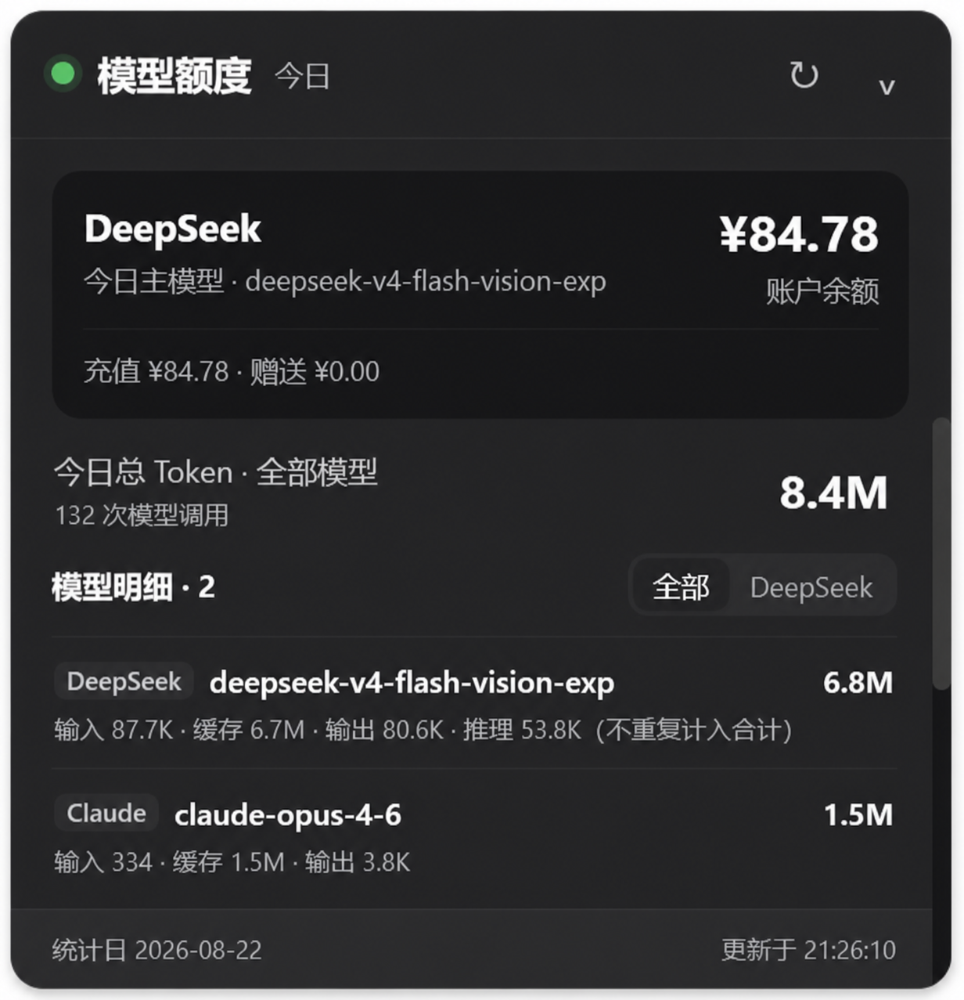

# dsh-model-quota-usage

DeepSeek Harness Web 插件：在一个可拖动、可折叠的悬浮面板中显示 DeepSeek 官方账户余额，以及今日全部 Provider/模型的 Token 用量。



## 功能

- 只显示 DeepSeek 开放平台账户余额；
- 汇总今日所有 Provider、所有模型的 Token；
- 按 Provider / 模型列出输入、缓存、输出和合计 Token；
- 支持“全部 / DeepSeek”筛选和手动刷新；
- 面板可拖动并自动记忆位置；
- 使用屏幕边缘锚定，展开与收起不会发生位置漂移；
- 双击标题栏或收起后的悬浮条可恢复默认右下角；
- 60 秒自动刷新本地统计；
- 复用 `~/.dsh/storages/cost-meter/ledger.json`，保留已有历史。

## Token 口径

合计 Token = 输入 + 缓存读取 + 缓存写入 + 输出。

推理 Token 单独显示在模型详情中，不重复加入合计，避免部分 Provider 已将推理 Token 包含在输出时发生双计。

## 安装

从 GitHub 安装：

```powershell
dsh plugin --profile web add "github:Hades03/dsh-model-quota-usage"
```

本地开发安装：

```powershell
dsh plugin --profile web add "link:<本仓库绝对路径>"
```

安装或更新后重启 DeepSeek Harness Desktop。

## 兼容性

- DeepSeek Harness `>= 0.2.0-rc.1`
- Node.js `>= 20`
- Web profile / DeepSeek Harness Desktop

当前兼容性下限采用已完成实机验证的 Harness 版本，避免对未测试的早期开发预览 API 作宽泛承诺。

## 数据与权限

- Token 账本只保存在本机；
- 不包含遥测，不上传会话标题或 Token 历史；
- DeepSeek API Key 由 Harness 凭据服务读取；
- 公开运行版仅访问 `https://api.deepseek.com` 的官方余额接口；
- Token 统计覆盖 DeepSeek、Kimi、GPT、GLM、Claude 等所有 Harness Provider，但不会查询这些 Provider 的账户余额。

更多说明见 [SECURITY.md](SECURITY.md)。

## 开发与验证

```powershell
npm run check
npm test
npm pack --dry-run
```

发布检查会验证插件清单、GitHub 元数据、网络权限和全部 JavaScript 文件语法。测试覆盖悬浮面板的边缘锚定、展开/收起位置保持及旧坐标迁移。

## 版本

当前版本：`1.1.1`。变更记录见 [CHANGELOG.md](CHANGELOG.md)。

## 上游与许可证

本项目基于 MIT 许可证的 [dsh-cost-meter](https://github.com/Han-1413141/dsh-cost-meter) 1.5.38 定制，保留其可靠的跨 Provider 用量采集、DeepSeek 余额查询和本地账本基础实现。

许可证见 [LICENSE](LICENSE)，衍生说明见 [NOTICE](NOTICE)。
